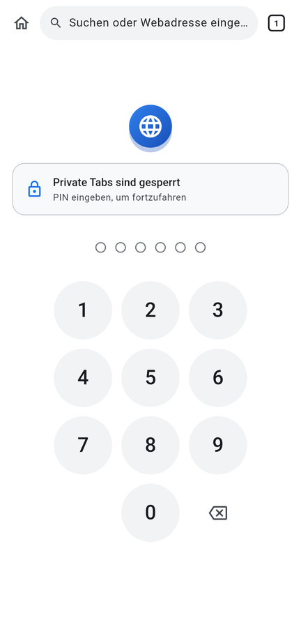
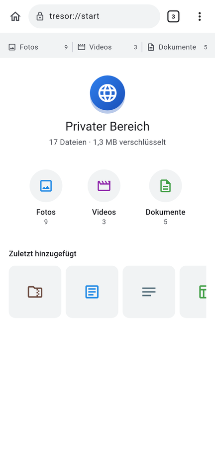
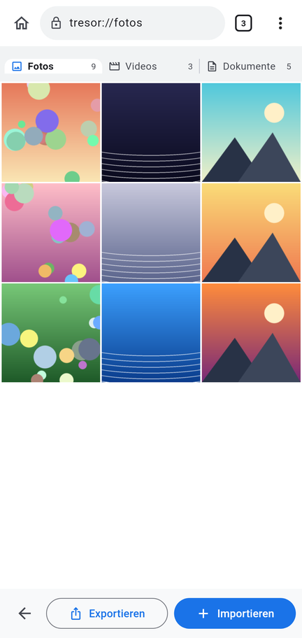
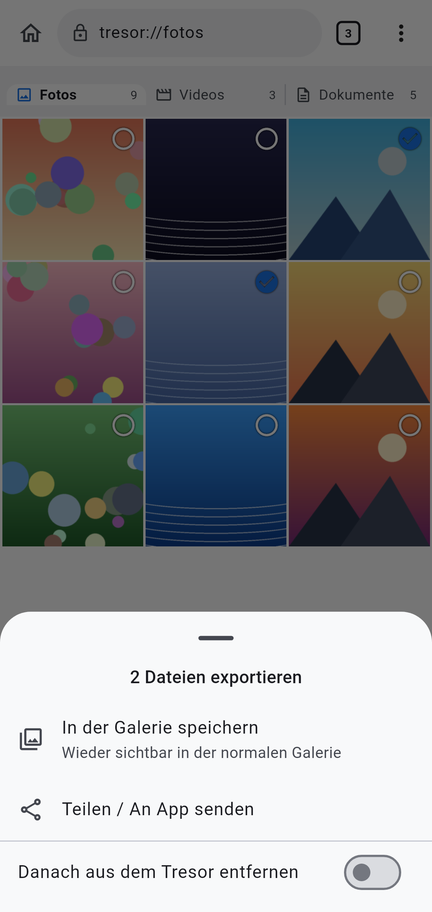

# Browser-Tresor

Eine App, die aussieht wie ein Internet-Browser, in Wirklichkeit aber ein
verschlüsselter Tresor für **Fotos, Videos und Dokumente** ist. Was du hier
ablegst, ist in der normalen Galerie und für andere Apps nicht mehr sichtbar.

| Sperrbildschirm | Startseite | Fotos | Export |
|---|---|---|---|
|  |  |  |  |

## Funktionen

- **Tarnung als Browser:** App-Name „Browser“, Globus-Icon, Adressleiste,
  Tabs und Menü wie in einem mobilen Browser. Die Adressleiste auf dem
  Sperrbildschirm funktioniert wirklich: Eingaben öffnen sich im normalen
  Browser.
- **Sperre beim Start:** Beim Öffnen wird nach der **PIN** oder dem
  **Fingerabdruck** (bzw. Face ID) gefragt („Private Tabs sind gesperrt“).
- **Einrichtung:** Beim ersten Start muss eine Sicherheits-PIN (4–12 Ziffern)
  festgelegt und bestätigt werden. Danach kann der Fingerabdruck aktiviert
  werden.
- **Kategorien als Tabs:** Fotos, Videos und Dokumente. Die Adressleiste
  (`tresor://fotos`) durchsucht den aktuellen Tab.
- **Import in jedem Tab:** „Importieren“ → *Aus der Galerie* (mit Option, die
  Originale danach aus der Galerie zu löschen) oder *Aus Dateien* (Downloads,
  SD-Karte, Cloud …).
- **Export in jedem Tab:** „Exportieren“ → Dateien antippen → *In der Galerie
  speichern*, *In einem Ordner speichern* (Android) oder *Teilen / An App
  senden*. Optional danach aus dem Tresor entfernen.
- **Ansehen in der App:** Fotos mit Wischen und Zoom, Video-Player,
  Textdateien; andere Dokumente (PDF, Word …) werden mit der passenden App
  geöffnet.
- **Schutz:** automatische Sperre beim Verlassen der App (einstellbar),
  Screenshots und App-Übersicht werden blockiert (Android), nach 5 falschen
  PINs wachsende Wartezeit.

## Sicherheit

- Jede Datei wird mit **AES-256-GCM** verschlüsselt und im privaten Speicher
  der App abgelegt (`files/<zufällige-id>.trv`). Auch Dateinamen und
  Vorschaubilder sind verschlüsselt.
- Der Schlüssel ist zufällig und wird mit einem aus der PIN abgeleiteten
  Schlüssel (PBKDF2-HMAC-SHA256, 100 000 Runden) geschützt. Eine PIN-Änderung
  verschlüsselt nur diesen Schlüssel neu.
- Für den Fingerabdruck liegt eine Kopie des Schlüssels im Android Keystore
  bzw. iOS-Schlüsselbund und wird erst nach erfolgreicher Prüfung freigegeben.
- Zum Ansehen/Teilen entschlüsselte Kopien liegen nur kurz im privaten
  Cache und werden beim Sperren gelöscht.

> **Wichtig:** Wer die App deinstalliert oder ihre Daten löscht, löscht auch
> den Tresor. Ohne PIN gibt es keinen Zugriff – auch nicht für dich.
> Exportiere wichtige Dateien vorher.

## Installation

### Android

1. Unter [Releases](../../releases/latest) die Datei **`Browser-Tresor.apk`**
   auf dem Handy herunterladen.
2. Öffnen und die Installation aus unbekannten Quellen einmalig erlauben.
3. „Browser“ starten, PIN festlegen, fertig.

Die APK wird bei jedem Push automatisch von GitHub Actions gebaut
(`.github/workflows/build.yml`).

### iPhone

Für iOS gibt es ohne Apple-Developer-Konto keine direkt installierbare Datei.
Der Build erzeugt `Browser-Tresor-unsigned.ipa`, die du mit einem
Sideloading-Tool (z. B. AltStore oder Sideloadly) mit deiner Apple-ID
installieren kannst. Alternativ auf einem Mac mit Xcode: `flutter run --release`.

### Eigener Signaturschlüssel (für Updates)

Android installiert eine neue Version nur dann als Update, wenn sie mit
demselben Schlüssel signiert ist. Ohne eigenen Schlüssel signiert der Build
mit einem wechselnden Debug-Schlüssel – dann müsste die App für ein Update
deinstalliert werden (**Tresor-Inhalt vorher exportieren!**).

Einmalig einrichten (Rechner mit Java):

```bash
keytool -genkeypair -v -keystore release.jks -alias browser \
  -keyalg RSA -keysize 4096 -validity 10000
base64 -w0 release.jks   # Ausgabe kopieren
```

Dann im GitHub-Repository unter *Settings → Secrets and variables → Actions*
anlegen:

| Secret | Wert |
|---|---|
| `ANDROID_KEYSTORE_BASE64` | die base64-Ausgabe |
| `ANDROID_KEYSTORE_PASSWORD` | Passwort des Keystores |
| `ANDROID_KEY_ALIAS` | `browser` |
| `ANDROID_KEY_PASSWORD` | Passwort des Schlüssels (meist dasselbe) |

`release.jks` gut aufbewahren und **nie** ins Repository hochladen.

## Entwicklung

Flutter 3.47 (Dart 3.13).

```bash
flutter pub get
flutter analyze
flutter test
flutter run            # Android-Gerät oder Emulator
flutter build apk      # Release-APK
```

Aufbau:

| Pfad | Inhalt |
|---|---|
| `lib/core/vault_format.dart` | Dateiformat und Verschlüsselung (Dart) |
| `lib/core/vault.dart` | Tresor: Index, Import, Löschen, Vorschaubilder |
| `lib/core/key_manager.dart` | PIN, Hauptschlüssel, Fingerabdruck |
| `lib/core/session.dart` | Gesperrt/entsperrt, Auto-Sperre, Fehlversuche |
| `lib/ui/` | Browser-Oberfläche, Sperrbildschirm, Import/Export, Viewer |
| `android/.../VaultCrypto.java`, `MainActivity.kt` | Schnelle Verschlüsselung, Ordner-Export, Bildschirmschutz (Android) |
| `ios/Runner/AppDelegate.swift` | Dasselbe für iOS (CryptoKit) |

Dart-, Java- und Swift-Implementierung schreiben und lesen exakt dasselbe
Format (`TRV1`, Details in `vault_format.dart`).
